# 포트폴리오 ERD — PostgreSQL v1

2026-10-20 포트폴리오 명세서의 단일 원본·중복방지·공개 범위 원칙을 반영한 구현이다. 실제 SQL은 `db/schema.sql`이 단일 기준이며, 아래는 관계의 간략화된 표시다.

```mermaid
erDiagram
  profile {
    text id PK
    text name_ko
    text name_en
  }
  projects {
    text id PK
    text slug UK
    text name
    text status
    boolean is_featured
    date started_at
    date ended_at
  }
  project_metrics {
    text id PK
    text project_id FK
    text metric_key
    text display_value
  }
  technologies {
    text id PK
    text name UK
    text category
    text proficiency
  }
  project_technologies {
    text project_id PK, FK
    text technology_id PK, FK
    numeric effort_weight
    text verification_status
  }
  experiences {
    text id PK
    text name
    text category
    date started_at
  }
  recognitions {text id PK
    text experience_id FK
    text related_project_id FK
  }
  leadership {text id PK
    text experience_id FK
  }
  participations {text id PK
    text experience_id FK
  }
  employment {text id PK
    text experience_id FK
  }
  education {text id PK
    text experience_id FK
  }
  certifications {text id PK
    text experience_id FK
  }
  project_experiences {text project_id PK, FK
    text experience_id PK, FK
  }
  media_assets {text id PK
    text external_url
    text storage_key
  }
  asset_links {text id PK
    text asset_id FK
    text entity_type
    text entity_id
  }
  tags {text id PK
    text name UK
  }
  experience_tags {text experience_id PK, FK
    text tag_id PK, FK
  }
  goals {text id PK
    text title
  }
  site_content {text key PK
    text ko
    text en
  }
  projects ||--o{ project_metrics : metrics
  projects ||--o{ project_technologies : uses
  technologies ||--o{ project_technologies : used_in
  projects ||--o{ project_experiences : linked_to
  experiences ||--o{ project_experiences : includes
  experiences ||--o| recognitions : award_detail
  experiences ||--o| leadership : leadership_detail
  experiences ||--o| participations : participation_detail
  experiences ||--o| employment : work_detail
  experiences ||--o| education : education_detail
  experiences ||--o| certifications : certification_detail
  projects |o--o{ recognitions : award_related
  media_assets ||--o{ asset_links : assigned_to
  experiences ||--o{ experience_tags : tagged
  tags ||--o{ experience_tags : used_by
```

## 구현 원칙

- `project_technologies`의 관계는 **실제 프로젝트 사용이 확인된 경우에만** `confirmed`로 입력한다. 기술 분포도의 원 크기는 해당 기술의 `confirmed` 프로젝트 개수이다.
- `effort_weight`는 추후 선택적으로 사용할 상대 기여도 필드(0~100)다. 지금 시각화의 원 크기를 부풀리지 않는다.
- `recognitions`의 수상/장학/배지는 `recognition_type`으로 구분하며, `certifications`는 취득 자격증만 별도 조회한다.
- `experiences`는 통합 마스터 테이블이다. 아직 원본 통합 이력 47건의 모든 상세 데이터가 제공된 것이 아니므로 **임의로 47건을 생성하지 않는다**. 참여 상태가 검증되지 않은 31개 원본 프로그램 항목은 `participations`에 별도로 보존한다.
- `asset_links`는 다형성(`entity_type`, `entity_id`) 연결이다. DB 수준 외래키가 아닌 애플리케이션 레벨 참조이므로 편집 시 대상 ID를 확인해야 한다.
- ID는 원본 시안의 안정적인 `project-01`, `tech-01` 형태를 그대로 보존하기 위해 `TEXT`로 사용했다. 나중에 UUID로 교체하더라도 `source_notion_id`를 잃지 않는다.
- `site_content`에서 히어로, 소개, 챕터 제목, 엔딩 문구를 한국어/영어로 관리한다. 디자인 컬러, 상태명 등 UI 상수는 코드에 둔다.
- `is_public`, `source_code_visibility`, `verification_status`는 서로 독립적이다.
