# 포트폴리오 ERD — 운영 PostgreSQL 17

기준: `db/live-schema.sql` (2026-10-30, 운영 `portfolio-postgres` 컨테이너에서 `pg_dump --schema-only`로 추출, PostgreSQL 17.11).
이 파일이 실제 구조의 단일 기준이다. `db/schema.sql`은 초기 프로토타입(TEXT ID, `profile`, `site_content` 등)이며 운영 DB와 다르다.

- 테이블 20개, 외래키 33개, `updated_at` 자동 갱신 트리거 14개(`portfolio_touch_updated_at()`).
- 모든 PK는 `uuid DEFAULT gen_random_uuid()`. 조인 테이블 3개는 복합 PK.
- 열거형 값은 모두 `CHECK (col = ANY (ARRAY[...]))` 제약으로 관리한다.

```mermaid
erDiagram
  profiles {
    uuid id PK
    text name_ko
    text name_en
    text headline
    text intro_title
    text bio
    text email
    uuid profile_image_id FK
  }
  projects {
    uuid id PK
    text slug UK
    text name
    text summary
    text description
    text content_markdown
    text project_type
    text status
    boolean is_featured
    date started_at
    date ended_at
  }
  project_aliases {
    uuid id PK
    uuid project_id FK
    text alias
    text alias_type
  }
  project_metrics {
    uuid id PK
    uuid project_id FK
    text metric_key
    text display_value
    boolean is_verified
  }
  technologies {
    uuid id PK
    text name UK
    text category
    text proficiency
  }
  project_technologies {
    uuid project_id PK, FK
    uuid technology_id PK, FK
    text usage_note
    boolean is_primary
  }
  technology_evidence {
    uuid id PK
    uuid technology_id FK
    uuid experience_id FK
    uuid recognition_id FK
    uuid participation_id FK
    uuid education_id FK
    uuid employment_id FK
    uuid leadership_id FK
    uuid certification_id FK
    text evidence_kind
    text evidence_note
  }
  experiences {
    uuid id PK
    text name
    text category
    text status
    boolean is_ongoing "generated"
    date started_at
  }
  project_experiences {
    uuid project_id PK, FK
    uuid experience_id PK, FK
    text relationship_type
  }
  recognitions {
    uuid id PK
    uuid experience_id FK, UK
    uuid related_project_id FK
    uuid evidence_asset_id FK
    text recognition_type
    text award_name
  }
  certifications {
    uuid id PK
    uuid experience_id FK, UK
    text name
    text status
  }
  education {
    uuid id PK
    uuid experience_id FK, UK
    text school_name
    text status
  }
  employment {
    uuid id PK
    uuid experience_id FK, UK
    text company_name
  }
  leadership {
    uuid id PK
    uuid experience_id FK, UK
    uuid related_project_id FK
    text activity_name
  }
  participations {
    uuid id PK
    uuid experience_id FK, UK
    uuid related_project_id FK
    text title
    text attendance_status
  }
  tags {
    uuid id PK
    text name UK
  }
  experience_tags {
    uuid experience_id PK, FK
    uuid tag_id PK, FK
  }
  goals {
    uuid id PK
    text title
    text status
  }
  media_assets {
    uuid id PK
    text media_type
    text storage_key
    text external_url
  }
  asset_links {
    uuid id PK
    uuid asset_id FK
    uuid profile_id FK
    uuid project_id FK
    uuid experience_id FK
    uuid recognition_id FK
    uuid certification_id FK
    text asset_role
  }

  projects ||--o{ project_aliases : "aliases (CASCADE)"
  projects ||--o{ project_metrics : "metrics (CASCADE)"
  projects ||--o{ project_technologies : "uses (CASCADE)"
  technologies ||--o{ project_technologies : "used in (CASCADE)"
  projects ||--o{ project_experiences : "linked (CASCADE)"
  experiences ||--o{ project_experiences : "linked (CASCADE)"
  experiences ||--o| recognitions : "detail (SET NULL)"
  experiences ||--o| certifications : "detail (SET NULL)"
  experiences ||--o| education : "detail (SET NULL)"
  experiences ||--o| employment : "detail (SET NULL)"
  experiences ||--o| leadership : "detail (SET NULL)"
  experiences ||--o| participations : "detail (SET NULL)"
  projects |o--o{ recognitions : "related (SET NULL)"
  projects |o--o{ leadership : "related (SET NULL)"
  projects |o--o{ participations : "related (SET NULL)"
  technologies ||--o{ technology_evidence : "evidence (RESTRICT)"
  experiences |o--o{ technology_evidence : "source (RESTRICT)"
  recognitions |o--o{ technology_evidence : "source (RESTRICT)"
  participations |o--o{ technology_evidence : "source (RESTRICT)"
  education |o--o{ technology_evidence : "source (RESTRICT)"
  employment |o--o{ technology_evidence : "source (RESTRICT)"
  leadership |o--o{ technology_evidence : "source (RESTRICT)"
  certifications |o--o{ technology_evidence : "source (RESTRICT)"
  experiences ||--o{ experience_tags : "tagged (CASCADE)"
  tags ||--o{ experience_tags : "used by (CASCADE)"
  media_assets ||--o{ asset_links : "linked (CASCADE)"
  profiles |o--o{ asset_links : "target (CASCADE)"
  projects |o--o{ asset_links : "target (CASCADE)"
  experiences |o--o{ asset_links : "target (CASCADE)"
  recognitions |o--o{ asset_links : "target (CASCADE)"
  certifications |o--o{ asset_links : "target (CASCADE)"
  media_assets |o--o{ profiles : "profile image (SET NULL)"
  media_assets |o--o{ recognitions : "evidence asset (SET NULL)"
```

## 구조상 특징

- **경력 계열은 마스터-상세 구조.** `experiences`가 통합 이력이고 `recognitions`·`certifications`·`education`·`employment`·`leadership`·`participations`가 `experience_id`(UNIQUE, 1:1)로 붙는다. 상세 행은 마스터 없이도 존재할 수 있다(`experience_id` nullable, 삭제 시 SET NULL).
- **배타적 다중 대상(exclusive arc).** `asset_links`는 5개 대상 중 정확히 하나(`asset_links_one_target_chk`), `technology_evidence`는 7개 출처 중 정확히 하나(`technology_evidence_check`)를 가리킨다.
- **다국어 컬럼은 `profiles.name_en` 하나뿐.** 프로젝트·기술·경력·수상의 이름과 설명은 단일 언어 컬럼(`name`, `summary`, `description`, `title`, `award_name` …)만 있다.
- **화면 문구 테이블(`site_content`)과 감사 로그 테이블은 없다.**
- **열거형 표기가 섞여 있다.** 소문자 snake_case(`status`, `technologies.category`), Title Case(`experiences.category`, `projects.project_type`, `date_precision`, `linkedin_sync_status`)가 공존한다.
- **Notion 이관 흔적.** 대부분 테이블에 `source_notion_id`(UNIQUE)가 있다.
- `experiences.is_ongoing`은 `status = 'ongoing'`에서 계산되는 생성 컬럼이다.
- 트리거가 없는 테이블: `asset_links`, `project_aliases`(`updated_at` 없음), 조인 테이블 3개(타임스탬프 없음).
