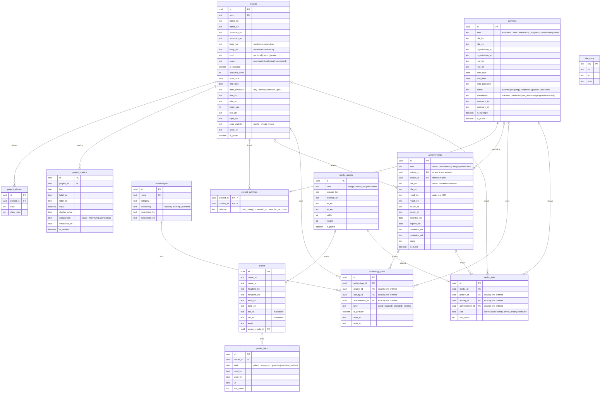

# DB v2 설계안 (초안)

상태: **제안 단계**. 운영 DB에는 아무것도 적용하지 않았다. 컬럼 단위 확정은 운영 데이터 집계(아래 「확정 전 확인할 데이터」)를 본 뒤에 한다.
현재 구조는 `db/live-schema.sql`, `db/ERD.md` 참고.

## 목표

1. **이중 언어를 DB에서 지원한다.** 화면에 보이는 텍스트는 `*_ko`(필수) + `*_en`(선택) 쌍으로 두고, 영어가 비면 앱이 한국어로 대체한다.
2. **경력 7개 테이블을 2개로 줄인다.** "한 일"은 `activities`, "받은 것"은 `achievements`.
3. **기술 연결 2개 테이블(`project_technologies` + `technology_evidence`)을 `technology_links` 하나로 합친다.** 대상은 프로젝트·활동·성과 중 하나.
4. **화면 문구(`site_copy`)를 DB로 관리한다.**
5. **안 쓰는 것을 걷어낸다.** `goals`, `tags`, `experience_tags`, `source_notion_id`, `linkedin_sync_status` 등(데이터 확인 후 확정).
6. **표기 규칙을 통일한다.** 열거형 값은 전부 소문자 snake_case, 날짜는 `start_date`/`end_date` + `date_precision`.

테이블 수: 20개 → **13개**.

## ERD

모든 테이블에 `created_at`, `updated_at`(트리거 자동 갱신)과 공개용 테이블에는 `is_public`, `sort_order`가 있다. 다이어그램에서는 생략했다.

## 현재 → v2 대응

| 현재 (public) | v2 | 비고 |
|---|---|---|
| `profiles` | `profile` + `profile_links` | URL 컬럼 6개를 링크 행으로. 학교·학과는 `activities`(education)에서 가져와 중복 제거 |
| `projects` | `projects` | 이름·요약·본문·역할에 `_en` 추가. `description`·`key_contributions`·`result_summary`·`lessons_learned`·`content_markdown`은 `body`로 통합(선택지 ①) |
| `project_aliases`, `project_metrics` | 동일 | metrics에 `label_en` 추가 |
| `technologies` | `technologies` | `description_en` 추가 |
| `project_technologies` (41) + `technology_evidence` (8) | `technology_links` | 대상 7종 → 3종 |
| `experiences` + `education`·`employment`·`leadership`·`participations` | `activities` | 1:1로 붙어 있던 행은 하나로 합친다. id는 `experiences.id` 유지 |
| `recognitions` + `certifications` | `achievements` | `recognitions.title`(행사명)은 연결된 `activities.title`이 담당. id 유지 |
| `experiences` 중 장학·자격 전용 마스터 행 | (삭제) | 성과 자체가 `achievements`로 존재하므로 빈 껍데기 마스터가 필요 없다 |
| `project_experiences` | `project_activities` | |
| `media_assets`, `asset_links` | `media_assets`, `media_links` | 대상 5종 → 3종(+ 프로필 사진은 `profile.avatar_media_id`) |
| 없음 | `site_copy` | 화면 문구 ko/en |
| `goals`, `tags`, `experience_tags` | (삭제 후보) | 데이터 확인 후 결정 |

**UUID는 그대로 유지한다.** 합치는 경우에도 기존 행의 id를 새 행의 id로 쓰므로, 외부에 노출된 링크나 백업과의 대조가 끊기지 않는다.

## 이관 순서 (운영 영향 최소화)

1. **백업** — `db/BACKUP_WORKFLOW.md` 절차대로 before 스냅샷 + Obsidian 기록.
2. **리허설** — 서버에서 전체 덤프를 일회용 DB(또는 컨테이너)에 복원하고, 그 위에서 v2 생성·이관 SQL을 실행해 행 수와 샘플을 대조한다. 운영 DB는 건드리지 않는다.
3. **v2 생성** — 운영 DB 안에 별도 스키마 `v2`를 만들고 이관한다. 기존 `public`은 그대로 두므로 현재 사이트는 계속 동작한다.
4. **앱 전환** — 새 앱은 `v2`를 읽는다. 전환은 환경변수 하나로 하며, 문제가 생기면 되돌리면 된다.
5. **정리** — 안정화 후 별도 승인을 받아 `public`의 옛 테이블을 정리한다.
6. **번역** — 이관 직후 `_en`은 비어 있다. 관리 화면에서 채우거나, 초안 번역을 만들어 검토 후 반영한다.

## 결정이 필요한 것

- ① 프로젝트 본문: 섹션별 컬럼(개요·기여·성과·회고)을 유지할지, 마크다운 본문 하나로 합칠지. 제안은 **마크다운 하나**(케이스 스터디 구성을 자유롭게).
- ② 교육 전용 값(학점, 학년 등)을 `activities`의 선택 컬럼으로 둘지, 아예 뺄지.
- ③ `goals`, `tags` 삭제 여부.

## 확정 전 확인할 데이터

컬럼별 채움 비율(값 자체는 보지 않음)과 분류별 건수. 비어 있는 컬럼은 v2에서 뺀다.
