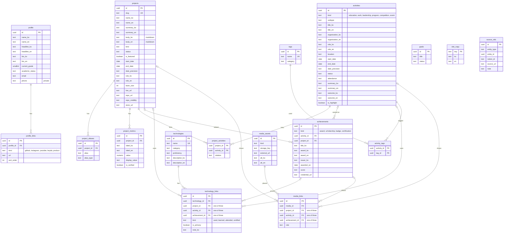

# DB v2 설계안

상태: **제안 (운영 데이터 집계 반영, 2026-10-30)**. 운영 DB에는 아무것도 적용하지 않았다.
현재 구조는 `db/live-schema.sql`, `db/ERD.md` 참고. 일반 독자용 요약은 PDF 보고서로 별도 제공.

## 목표

1. **이중 언어를 DB에서 지원한다.** 화면에 보이는 텍스트는 `*_ko`(필수) + `*_en`(선택). 영어가 비면 앱이 한국어로 대체한다.
2. **경력 7개 테이블을 2개로 줄인다.** "한 일" = `activities`, "받은 것" = `achievements`.
3. **기술 연결 2개 테이블을 `technology_links` 하나로 합친다.** 대상은 프로젝트·활동·성과 중 하나.
4. **화면 문구(`site_copy`)를 DB로 관리한다.**
5. **한 번도 쓰이지 않은 칸(0건)은 뺀다.** 쓰이는 데이터는 하나도 버리지 않는다.
6. **Notion 출처 기록은 `source_refs` 한 곳으로 모은다.** 화면 데이터와 이관용 추적 정보를 분리한다.
7. **표기 통일.** 열거형은 소문자 snake_case, 날짜는 `start_date`/`end_date` + `date_precision`.

테이블: 20개 → **17개**.

## 운영 데이터 집계 요약 (값은 보지 않음, 건수만)

| 대상 | 건수 | 메모 |
|---|---|---|
| projects | 19 | 본문 계열: description 19, key_contributions 16, result_summary 14, tech_stack_summary 19 |
| experiences | 47 | 상세 0개 4건, 1개 36건, 2개 7건 |
| participations | 31 | attended 10, completed 17, unknown 4 · 마스터 없는 행 1 |
| leadership | 9 | 마스터 없는 행 1 |
| recognitions / certifications | 8 / 1 | award 5, scholarship 2, badge 1 |
| education / employment | 2 / 1 | |
| technologies / 연결 | 33 / 41 + 근거 8 | |
| tags / 연결 | 13 / 72 | **사용 중** |
| goals | 4 | 비공개 개인 목표 |
| project_metrics / aliases / project_experiences | 7 / 8 / 4 | |
| media_assets / asset_links | 0 / 0 | 아직 미사용 |

**한 번도 채워지지 않은 칸(0건)** — v2에서 제외:
`projects`: content_markdown, planned_end_at, ownership, team_label, lessons_learned, evidence_url, linkedin_sync_status ·
`experiences`: subcategory, content_markdown, location, outcome_at, credential_id, credential_url, linkedin_sync_status ·
`participations`: instructor, role, outcome · `education`: gpa, gpa_scale, expected_end_at ·
`recognitions`: rank_or_result, academic_year, evidence_asset_id · `certifications`: credential_number, expires_at ·
`project_technologies`: usage_note · `profiles`: profile_image_id.

## ERD

모든 테이블에 `created_at`, `updated_at`(트리거)이 있고, 공개 대상 테이블에는 `is_public`, `sort_order`가 있다(다이어그램에서는 생략).

## 현재 → v2 대응

| 현재 | v2 | 처리 |
|---|---|---|
| `profiles` (1) | `profile` + `profile_links` | URL 5개 → 링크 행. 학교·학과는 education 활동에서 가져온다 |
| `projects` (19) | `projects` | description·key_contributions·result_summary·tech_stack_summary를 소제목이 있는 마크다운 `body_ko`로 합친다(글자 손실 없음) |
| `project_aliases` (8), `project_metrics` (7) | 동일 | metrics에 `label_en` 추가 |
| `project_experiences` (4) | `project_activities` | |
| `technologies` (33) | `technologies` | `description_en` 추가 |
| `project_technologies` (41) + `technology_evidence` (8) | `technology_links` (49) | |
| `experiences` (47) + `education` (2) · `employment` (1) · `leadership` (9) · `participations` (31) | `activities` (약 46) | 1:1로 붙은 행은 하나로 합침. 마스터 없는 참여 1·리더십 1은 각각 새 활동 |
| `recognitions` (8) + `certifications` (1) | `achievements` (9) | 행사명은 `title`, 상 이름은 `award` |
| 장학·자격 전용 마스터 경험 3건 | 제거 | 성과 자체가 `achievements`에 있음. 단 태그·근거가 붙어 있으면 활동으로 남긴다 |
| `tags` (13), `experience_tags` (72) | `tags`, `activity_tags` | 유지 |
| `goals` (4) | `goals` | 유지(비공개) |
| `media_assets`, `asset_links` (0) | `media_assets`, `media_links` | 스크린샷·포스터용으로 유지 |
| 없음 | `site_copy` | 화면 문구 |
| 각 테이블의 `source_notion_id`, `source_url`, `start_date_source` | `source_refs` | 출처 추적 정보 한곳에 보관 |

**UUID는 유지한다.** 합칠 때도 원래 행의 id를 새 행의 id로 쓴다.

## 이관 순서

1. **백업** — `db/BACKUP_WORKFLOW.md` 절차(before 스냅샷 + Obsidian 기록).
2. **리허설** — 서버에서 전체 덤프를 일회용 DB에 복원해 v2 생성·이관 SQL을 실행하고, 건수·샘플을 대조한다.
3. **v2 생성** — 운영 DB 안 별도 스키마 `v2`에 만든다. 기존 `public`은 그대로라 현재 사이트는 계속 동작한다.
4. **앱 전환** — 환경변수로 `v2`를 읽게 한다. 되돌리기도 환경변수 하나.
5. **정리** — 안정화 후 별도 승인으로 옛 테이블 정리.
6. **번역** — `_en`은 비어서 시작. 관리 화면에서 채우거나 초안 번역 후 검토.

## 리허설에서 확인할 것

- 상세 행이 2개인 경험 7건이 「활동 1 + 성과 1」 조합인지(활동형 상세가 둘이면 중단하고 보고).
- 장학·자격 전용 마스터 3건에 태그·기술 근거·프로젝트 연결이 붙어 있는지.
- 이관 전후 건수: 프로젝트 19, 활동 약 46, 성과 9, 기술 연결 49, 태그 연결 72, 지표 7, 별칭 8.

## 다국어 운영 방식 (2026-10-30 결정)

- 두 언어를 **각각 저장**한다. 보는 순간 자동 번역(번역 API)은 쓰지 않는다.
- 소유자는 한국어(`*_ko`)만 쓰고, 영어(`*_en`)는 Claude가 번역해 소유자 확인 후 넣는다.
- 의도가 불분명하면 추측하지 않고 묻는다. 세부 원칙은 `docs/translation-guide.md`.
- 이관 시 기존 공개 텍스트(약 455칸, 9,400자)의 영어 초안을 검토표로 한 번에 만든다.

## 결정이 필요한 것

- ① 프로젝트 본문을 마크다운 하나로 합칠지 (권장: 합침, 소제목으로 기존 구분 유지).
- ② 학점·졸업예정일: 데이터 0건이므로 제외 (권장).
- ③ `tags`·`goals`: 실제 데이터가 있으므로 유지 (권장).
